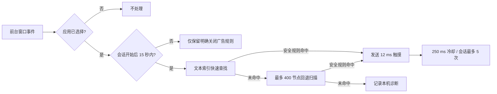

# 轻跳（QingTiao）

一款面向 Android 的本地开屏广告跳过助手。轻跳通过系统无障碍服务读取**用户主动选择的应用**所公开的界面控件，在应用启动后的短时间内识别明确的“跳过广告”“跳过 2”“Skip ad”等按钮，并发送点击或短触摸手势。

- 当前版本：**0.3.0-beta.1**（versionCode 12）
- 系统要求：**Android 8.0（API 26）及以上**
- 安装包：[下载最新 Release](../../releases/latest)

> 轻跳不能保证消除所有广告。图片、自绘控件、未向无障碍服务公开节点的 WebView、强制倒计时，以及没有跳过入口的广告，可能无法处理。

## 功能

- 只处理你在“选择应用”中勾选并保存的应用，默认不选择任何第三方应用。
- 应用选择支持按名称或包名搜索，选择内容只在点击“保存”后一次性落盘。
- 前台应用会话开始后的 15 秒内识别明确的跳过文字、数字倒计时跳过文字和带广告标识的通用跳过按钮。
- 优先使用 Android 的文本索引定位候选控件，未命中时再遍历最多 400 个无障碍节点。
- 明确命中后对按钮中心发送 12 毫秒触摸手势；必要时对经过尺寸、层级和标签校验的紧凑可点击父控件执行点击。
- 同一会话最多发送 5 次点击请求，重复请求间隔至少 250 毫秒。
- 点击前重新读取实时控件，避免界面动画结束后点击已经失效的旧节点。
- 锁屏、系统敏感应用，以及包含输入框、密码或身份验证内容的页面会停止自动点击。
- 提供独立的“关闭广告”规则开关；不会把普通“关闭”、无标识叉号或付款按钮当作广告按钮。
- 包含 QQ 音乐已验证开屏结构的快速路径，以及大麦已确认的启动促销弹窗关闭控件。
- 提供内置模拟广告页、普通按钮误触检查、最近一次诊断和本机点击统计。
- 提供用户主动触发的诊断导出、GitHub 问题反馈和下载地址分享入口。
- 所有识别在本机完成，不联网、不截图、不上传屏幕内容。

## 工作流程



## 安装和首次使用

1. 在 [Releases](../../releases) 下载当前测试版 APK；稳定需求可继续使用 `qing-tiao-0.2.0.apk`。
2. 允许浏览器或文件管理器安装来自此来源的应用，然后完成安装。
3. 打开轻跳，阅读权限用途说明，点击“同意并前往设置”。
4. 在系统无障碍设置中找到“轻跳 · 自动跳过”，由你手动开启。
5. 返回轻跳，确认总开关开启，点击“选择应用”，勾选要处理的应用并保存。
6. 先运行“模拟广告测试”，确认开屏广告会自动关闭、普通按钮不会被点击。
7. 冷启动已选择的目标应用，结合轻跳首页的“最近诊断”判断规则是否命中。

出现误触时，请立即关闭首页总开关或取消对应应用选择。系统已经接收的触摸手势无法撤销。

## 华为 / HarmonyOS 设置

HarmonyOS 4.x 可能在清理后台、重启、系统优化或覆盖安装后关闭第三方无障碍服务。华为官方说明也提示，清理后台应用后无障碍服务可能被关闭。

建议完成以下设置：

1. 在最近任务中锁定轻跳。
2. 进入“设置 → 应用和服务 → 应用启动管理”，找到轻跳并关闭“自动管理”。
3. 允许“自动启动”“关联启动”和“后台活动”。
4. 系统清理、重启或安装新版后，回到无障碍设置检查服务是否仍开启。

参考：[华为手机无障碍服务自动关闭的处理方法](https://consumer.huawei.com/cn/support/content/zh-cn00410039/)

应用不能绕过系统静默重新开启无障碍权限，这是 Android / HarmonyOS 的安全限制。

## 识别规则

开屏窗口内，以下类型可以成为候选：

- 精确的“跳过广告”“Skip ad”“Skip advertisement”。
- 带 1–2 位数字倒计时的“跳过”或“Skip”，例如“跳过 2”“0秒跳过”“Skip (3s)”。
- 当前窗口存在受限广告标识时的精确“跳过”或“Skip”。
- 资源 ID 明确包含广告和跳过含义的可见控件。
- 已验证应用的已知控件：QQ 音乐开屏快速路径、大麦启动促销弹窗关闭按钮。

“关闭广告”“Close ad”“Close advertisement”由独立开关控制。轻跳不会按任意坐标盲点，也不会执行返回键。

## 隐私和权限

Android 清单没有申请网络、存储、相机、麦克风、位置、联系人、截屏或悬浮窗权限。无障碍服务入口受系统 `BIND_ACCESSIBILITY_SERVICE` 权限保护，必须由用户在系统设置中手动授权。

应用只保存这些本地数据：

- 总开关和“关闭广告”规则开关；
- 已选择的应用包名；
- 系统已接受的点击请求总数；
- 最近一次处理的应用包名、时间和诊断文字。

应用不保存页面正文或控件文字，卸载后应用私有数据会被系统清除。系统返回“点击请求成功”只说明系统接收了请求，不代表广告一定已经消失。

主动“导出诊断”时会打开 Android 系统分享页。诊断不包含页面正文或控件文字，但包含设备型号、系统版本和最近处理的应用包名；用户在发送前可以检查目标和内容。完整说明见 [隐私说明](docs/PRIVACY.md)。

## 已验证范围

- 0.3.0-beta.1 构建和规则测试：43 项规则及保护条件检查通过；APK zipalign、v2 和 v3 签名验证通过。
- 真机：HUAWEI Pura 70（ADY-AL10），HarmonyOS 4.2.0.243，Android API 31 兼容层。
- 设备上对 42 个用户已选择应用做过冷启动界面检查；其中捕获到知乎、微博、猫眼、网易云音乐、QQ 音乐、Livelab、美的洗衣机、腾讯视频和大麦的真实广告或跳过控件结构。

这些检查用于完善通用规则，不代表 42 个应用全部显示过广告，也不构成兼容率承诺。广告是否出现受账号、地区、缓存、投放和时间影响。

完整验证边界见 [VERIFICATION.md](VERIFICATION.md)，版本变化见 [CHANGELOG.md](CHANGELOG.md)。

## 已知限制

- 只依赖无障碍树可读信息，不使用 OCR、截图识别、VPN、DNS 拦截或远程规则库。
- 检测的是前台包名或窗口会话变化，不等同于应用进程真正启动。
- 厂商系统可能暂停后台服务或撤销无障碍开关。
- 应用改版后，既有文字、资源 ID 或控件层级可能失效。
- 过度放宽通用规则会增加误触风险，因此未知叉号、图片按钮和普通“关闭”不会被自动点击。
- 当前 APK 使用本地开发签名，后续如更换签名，Android 可能要求先卸载旧版再安装。
- 未完成任何应用商店的发布审核或兼容认证。

## iPhone / iOS

此项目不能用于 iPhone。iOS 不允许普通第三方应用通过类似 Android 无障碍服务的方式读取并点击其他应用的界面，APK 也不能安装到 iOS。

## 从源码构建

项目使用 Android SDK 自带的 `aapt2`、D8、zipalign、apksigner 与 JDK 直接构建，不需要下载 Gradle 依赖。

```powershell
powershell -ExecutionPolicy Bypass -File .\build.ps1 `
  -Sdk 'C:\path\to\Android\Sdk' `
  -Jdk 'C:\path\to\jdk-21' `
  -Platform 'android-36.1' `
  -BuildTools '36.1.0'
```

脚本会执行资源编译、Java 编译、43 项规则测试、DEX 转换、APK 对齐、开发签名及签名验证，最终输出 `build/ad-skip-assistant-debug.apk`。GitHub Actions 会在主分支、测试分支和拉取请求上使用 Android 35 重新执行同一构建流程。

构建脚本会在 `build/local-debug.jks` 生成本地调试密钥。该密钥已被 `.gitignore` 排除，只适合开发测试，不应作为正式生产签名。

## 项目结构

```text
app/src/main/               Android 清单、Java 源码和资源
tests/RulesTest.java        规则与误触保护测试
build.ps1                   无 Gradle 的本地构建脚本
VERIFICATION.md             最终版本验证范围与复测步骤
CHANGELOG.md                版本更新记录
docs/PRIVACY.md             隐私说明
docs/PRODUCT_STRATEGY.md    产品化、变现与推广路线
docs/STORE_LISTING.md       应用商店文案和审核材料草案
.github/ISSUE_TEMPLATE/     问题反馈模板
.github/workflows/          自动构建与规则测试
```

## 反馈问题

请使用 GitHub Issues，并提供：

- 手机品牌、型号和系统完整版本；
- 目标应用名称与版本；
- 广告出现位置、按钮上可见的文字；
- 轻跳首页“最近诊断”的文字；
- 问题属于未识别、速度慢、误触，还是无障碍服务自动关闭。

请先遮挡账号、手机号、聊天内容等隐私信息，不要提交账号密码、验证码或完整私人页面截图。

## 许可证

当前仓库尚未指定开源许可证。源代码可以公开查看，但在添加许可证前，不自动授予复制、修改或再发布权利。

## 官方资料

- [Android AccessibilityService API](https://developer.android.com/reference/android/accessibilityservice/AccessibilityService)
- [创建无障碍服务](https://developer.android.com/guide/topics/ui/accessibility/service)
- [华为：无障碍服务自动关闭的处理方法](https://consumer.huawei.com/cn/support/content/zh-cn00410039/)
